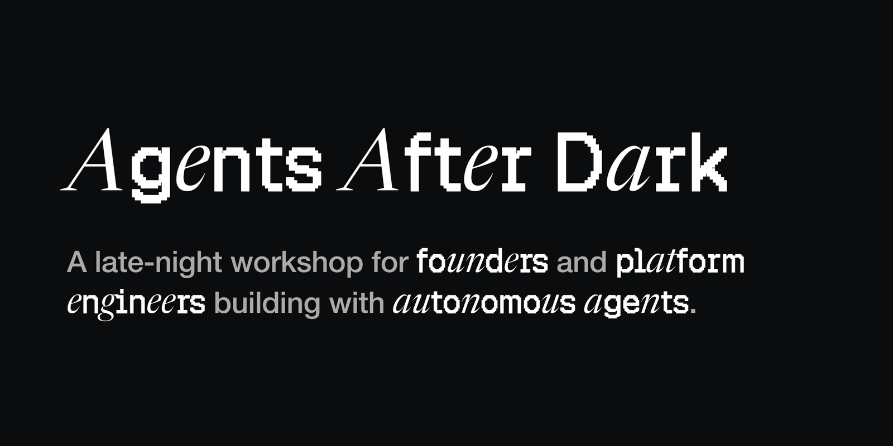
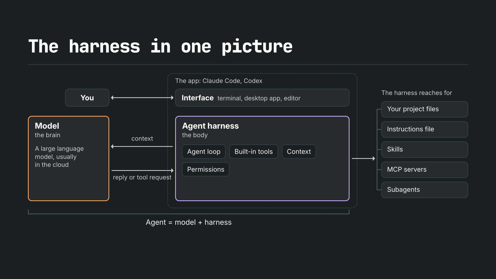

# ZazenCodes Skills

<p align="center">
  <a href="https://github.com/zazencodes/skills/releases/latest"></a>
  <a href="https://skills.sh/zazencodes/skills"></a>
  <a href="LICENSE"></a>
  
  
  <a href="https://zazencodes.com/"></a>
</p>

> **Part of [zstack](https://github.com/zazencodes/zstack)**, the agentic system I use to run ZazenCodes.

Agent skills that I use every day.

| Skill | What it does |
| --- | --- |
| [`adr`](skills/adr/SKILL.md) | Reads and writes Architecture Decision Records in `docs/adr/`. |
| [`ascii-viz`](skills/ascii-viz/SKILL.md) | Answers with ASCII diagrams and charts where they help. |
| [`codex-image-gen`](skills/codex-image-gen/SKILL.md) | Generates and edits images using your ChatGPT login. |
| [`diagram-viz`](skills/diagram-viz/SKILL.md) | Draws diagrams and timelines as images in the ZazenCodes style. |
| [`gemini-web-research`](skills/gemini-web-research/SKILL.md) | Runs parallel Gemini research jobs and verifies their findings. |
| [`git-commit-conventions`](skills/git-commit-conventions/SKILL.md) | Makes focused commits with short messages and your git authorship. |
| [`humanizer-tryhard`](skills/humanizer-tryhard/SKILL.md) | Revises prose in repeated editorial passes using seven focused guides with examples. |
| [`init-agents-md`](skills/init-agents-md/SKILL.md) | Writes a repo-specific `AGENTS.md` and links `CLAUDE.md` to it. |
| [`japanese-only`](skills/japanese-only/SKILL.md) | Keeps replies in Japanese until explicitly disabled. |
| [`random-number-generator`](skills/random-number-generator/SKILL.md) | Generates random numbers, picks, shuffles, samples, and secure tokens. |
| [`tavily-text`](skills/tavily-text/SKILL.md) | Sets headlines and key phrases in alternating pixel and serif italic letters. |
| [`terminal-explainer`](skills/terminal-explainer/SKILL.md) | Opens illustrated terminal walkthroughs with inspectable source and returns review feedback. |
| [`tldr`](skills/tldr/SKILL.md) | Summarizes replies in a few clear bullets. |

[Archived skills](archive/README.md)

## Installation

There are two ways to install. Pick one: installing both gives you every skill twice.

### Claude Code plugin

Installs the whole set as one managed plugin:

```bash
claude plugin marketplace add zazencodes/skills
claude plugin install zazencodes-skills@zazencodes
```

Or, from inside a session:

```
/plugin marketplace add zazencodes/skills
/plugin install zazencodes-skills@zazencodes
```

To receive updates automatically, open `/plugin`, select the **Marketplaces** tab, choose **zazencodes**, and enable auto-update. Custom marketplaces have auto-update off by default. To update manually:

```bash
claude plugin update zazencodes-skills@zazencodes
```

### skills.sh (Codex, Claude Code and other agents)

Copies the skill files into your agent's skills folder, so you can edit them:

```bash
npx skills@latest add zazencodes/skills
```

Pick the skills you want and which agents to install them on. To install one skill:

```bash
npx skills@latest add zazencodes/skills --skill <name>
```

Update later with `npx skills update`.

### Japanese-only replies

Install just this skill with `npx skills@latest add zazencodes/skills --skill japanese-only`, then invoke `/japanese-only` or `$japanese-only` in your agent. Replies stay in Japanese for the current conversation even if later prompts use another language. Say “disable japanese-only” to turn it off. Code, commands, and other necessary technical literals remain unchanged; higher-priority instructions and required output contracts still apply.

### Tavily Text

Sets a headline or key phrases with letters that switch between a pixel font and a serif italic inside each word. Install it with `npx skills@latest add zazencodes/skills --skill tavily-text`, then ask your agent to set a headline in Tavily Text.

<p align="center">
  
</p>

### Diagram Viz

Draws architecture diagrams, how-it-works pictures and timelines as PNG images in the ZazenCodes palette, from an HTML template your agent fills in and checks. Install it with `npx skills@latest add zazencodes/skills --skill diagram-viz`, then ask your agent for a diagram. It needs macOS, Google Chrome, and the Inter and JetBrainsMono Nerd Font fonts (`brew install --cask font-inter font-jetbrains-mono-nerd-font`).

<p align="center">
  
</p>

### Try the terminal walkthrough

The demo runs on macOS and Linux with `uv`. From this checkout, run:

```sh
uv run --script skills/terminal-explainer/scripts/explain.py demo
```

The demo includes its artwork. Inside tmux it opens in a new pane, zoomed to fill the window. For your own walkthrough, see the [authoring format](skills/terminal-explainer/references/authoring.md), [illustrator settings](skills/terminal-explainer/references/configuration.md), and [design](docs/terminal-explainer.md).

<p align="center">
  <a href="https://zazencodes.com/?utm_source=github&utm_medium=referral&utm_campaign=skills">
    
  </a>
  <br>
  Created by <a href="https://zazencodes.com/">ZazenCodes</a>
</p>

## License

[MIT](LICENSE). The `humanizer-tryhard` Wikipedia snapshot and focused guides are adapted from Wikipedia contributors under [CC BY-SA 4.0](https://creativecommons.org/licenses/by-sa/4.0/). Each file records its source revision and changes.
